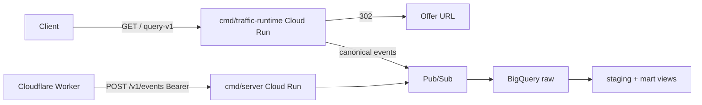

# ta-events-ingest

Go services for **traffic event ingest** and a **redirect runtime**.

The ingest API accepts edge events (single object or batch), validates them, hashes the client IP, and publishes a canonical record to Google Pub/Sub. A BigQuery subscription lands raw rows; ELT views do dedup and a click funnel. The optional traffic-runtime binary loads an immutable compiled contract and returns HTTP 302s, emitting the same canonical events on the request path.

This repository is a personal engineering sample: Cloud Run ingest, a Cloudflare Worker reverse-proxy, generation-pinned GCS artifacts, and a bounded in-process publish queue. Production project IDs, hosts, and secrets are not in the tree.

## Architecture



**Ingest** is extract+load only. It does not apply business transforms, bot scoring, or funnel logic.

**Traffic-runtime** keeps decision code as a pure function over an in-memory release. GCS and Pub/Sub sit on the load and telemetry paths, not on Resolve.

Event names for one visit, correlated by `click_id`:

1. `ingress` — accepted into the system
2. `scenario_assigned` — routing chose a scenario
3. `redirect` — 302 (from / to)
4. `pageview` — optional landing view

## API (ingest)

| Method / path | Purpose |
| --- | --- |
| `POST /v1/events` | One event (object) or a batch (array). `Authorization: Bearer <EVENTS_INGEST_SECRET>`. `202 Accepted`. |
| `GET /health` | Liveness (`200 ok`). Use this on Cloud Run. |
| `GET /healthz` | Same as `/health` (local / k8s). Cloud Run reserves `*z` paths. |

Error mapping: missing/wrong token → `401`; malformed JSON, unknown `event_name`, empty `click_id`, oversize batch/body/fields → `400`. Garbage input is not a `5xx`.

```bash
curl -X POST "http://127.0.0.1:8080/v1/events" \
  -H "Authorization: Bearer $EVENTS_INGEST_SECRET" \
  -H "Content-Type: application/json" \
  -d '[
    {"event_name":"ingress","click_id":"k7f3a1b2c","occurred_at":"2026-06-16T10:00:00.000Z","country":"DE","ta_source":"fb","ip":"1.2.3.4","url":"https://example.com/?ta_source=fb"},
    {"event_name":"scenario_assigned","click_id":"k7f3a1b2c","occurred_at":"2026-06-16T10:00:00.005Z","scenario_id":"smartlink","seed":"abc123"},
    {"event_name":"redirect","click_id":"k7f3a1b2c","occurred_at":"2026-06-16T10:00:00.006Z","scenario_id":"smartlink","smartlink_variant_id":"variant-a","redirect_to":"https://example.com/x?click_id=k7f3a1b2c"}
  ]'
```

Raw IP is never stored: `ip_hash = sha256(ip + IP_HASH_SALT)`.

## Run locally

Requires Go 1.26 (see `go.mod`). Pub/Sub is optional.

```bash
cp .env.example .env
make test
make run
# equivalent:
#   PUBLISHER=log \
#   EVENTS_INGEST_SECRET=dev-secret-change-me \
#   IP_HASH_SALT=dev-salt-change-me \
#   go run ./cmd/server
```

`PUBLISHER=log` prints accepted events and does not call GCP. For a real topic, set `PUBLISHER=pubsub`, `PROJECT_ID`, and Application Default Credentials (`gcloud auth application-default login`).

Traffic-runtime local (fixture redirect, no GCS):

```bash
PROTOTYPE_MODE=true \
PROTOTYPE_REDIRECT_URL=https://example.com/ \
go run ./cmd/traffic-runtime
```

## Test and lint

```bash
make fmt
make vet
make test
make race   # used in PR CI
```

Ingest unit tests mock the publisher. Traffic-runtime tests cover query allowlisting, packed affiliate IDs, edge-token country trust, and contract load.

## Configuration

| Variable | Required | Default | Purpose |
| --- | --- | --- | --- |
| `EVENTS_INGEST_SECRET` | yes | — | Bearer token for `POST /v1/events` |
| `IP_HASH_SALT` | yes | — | Salt for `ip_hash` |
| `PUBLISHER` | no | `pubsub` | `pubsub` or `log` (local) |
| `PROJECT_ID` | if `PUBLISHER=pubsub` | — | GCP project for Pub/Sub |
| `PUBSUB_TOPIC` | no | `ta-events` | Topic id |
| `PORT` | no | `8080` | HTTP port |
| `MAX_BATCH_SIZE` | no | `20` | Max events per request |
| `TRAFFIC_EDGE_TOKEN` | runtime | empty | Shared secret; event `country` is recorded only after a constant-time match on `X-Traffic-Edge-Token` |

Traffic-runtime also reads `ARTIFACT_SOURCE` (`dir` / `gcs`), optional `TRAFFIC_PIN_*` generation pins, and `TRAFFIC_CONTEXT_MODE` (`prototype` / `query-v1`). See [docs/architecture.md](docs/architecture.md).

## Layout

```
cmd/server/            ingest HTTP service
cmd/traffic-runtime/   redirect runtime
internal/ingest/       validate, canonicalize, HTTP handler
internal/pubsub/       Pub/Sub publisher + local log publisher
internal/config/       ingest env (fail-fast)
internal/traffic/      query-v1, handler, contract, pointer poll
internal/decision/     pure resolver over an immutable release
internal/runtimeloader GCS generation-pinned load path
deploy/                Avro schema, Pub/Sub bootstrap, BigQuery SQL
edge/                  Cloudflare Worker reverse-proxy
.github/workflows/     PR checks; Cloud Run deploy via WIF
```

## Deploy

PR CI: `gofmt`, `go vet`, `go test -race`, evaluator self-tests, both binaries.

Ingest deploy (`.github/workflows/deploy.yml`) runs on `main` when ingest paths change, **if** these GitHub repository variables are set:

- `GCP_PROJECT_ID`
- `GCP_REGION` (optional, default `europe-west1`)
- `GCP_RUNTIME_SA`
- `GCP_WIF_PROVIDER`

Secrets (never in git): `EVENTS_INGEST_SECRET`, `IP_HASH_SALT`.

One-time GCP bootstrap (owner, after substituting `YOUR_GCP_PROJECT` in SQL):

```bash
sed "s/YOUR_GCP_PROJECT/${PROJECT_ID}/g" deploy/bigquery.sql \
  | bq query --use_legacy_sql=false --location=EU
PROJECT_ID="$PROJECT_ID" ./deploy/pubsub.sh
sed "s/YOUR_GCP_PROJECT/${PROJECT_ID}/g" deploy/elt_staging.sql \
  | bq query --use_legacy_sql=false --location=EU
sed "s/YOUR_GCP_PROJECT/${PROJECT_ID}/g" deploy/elt_marts.sql \
  | bq query --use_legacy_sql=false --location=EU
```

Create the BigQuery table **before** the BigQuery subscription.

Traffic-runtime prototype deploy is `workflow_dispatch` only (`.github/workflows/traffic-runtime-proto.yml`).

## Security notes

- Bearer compare is constant-time; body size, batch size, and field lengths are capped.
- HTTP servers set read/write/idle timeouts and `MaxHeaderBytes`.
- Ingest publish ACK wait is a bounded goroutine pool with a timeout.
- Event `country` is not trusted from the query string; runtime records it only with a verified edge token and an ISO 3166-1 alpha-2 pin.

If you fork or publish this tree, rotate ingest/runtime secrets and prefer a **fresh git history**. Older commits in this repository still contain personal emails, GCP project identifiers, and hostnames even after HEAD is sanitized.
